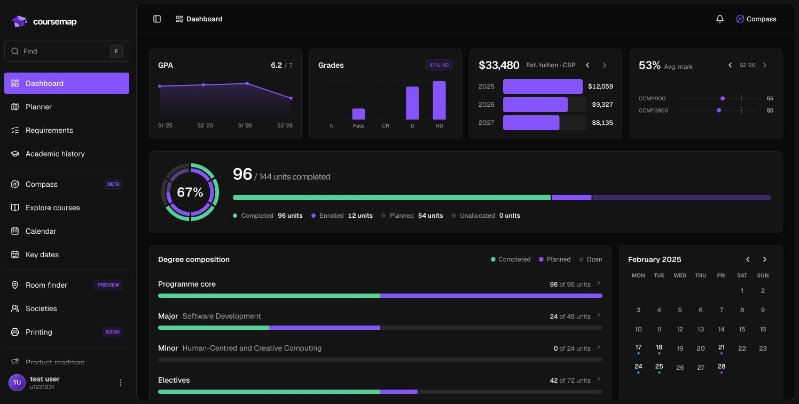
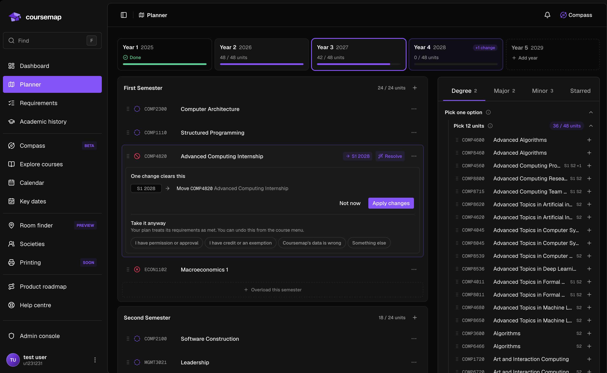
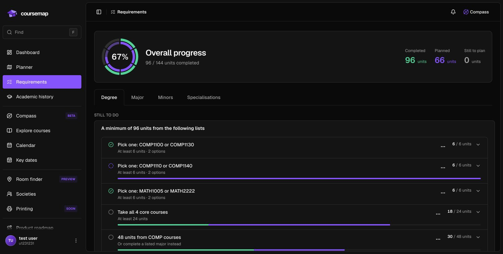

<div align="center">


# Coursemap

**Plan an ANU degree you can actually explain.**

Prerequisite paths, requirement audits, campus room finding and every key date,
in one place that updates when the catalogue does.

[](https://github.com/HarryRandall/Coursemap/actions/workflows/ci.yml)
[](https://nextjs.org)
[](https://supabase.com)
[](https://pnpm.io)



</div>

## What it does

Degree planning at ANU usually means a PDF, a spreadsheet and a lot of hope.
Coursemap replaces that with something that checks its own work.

- **Dashboard.** Track degree progress, GPA, results and estimated tuition in
  one overview.
- **Plan board.** Drag courses across years and semesters. Unit loads total
  themselves, and a course whose prerequisites are not met is flagged in place
  with a suggested fix.
- **Requirement audits.** Your plan is checked against the published programme
  rules, so you find the gap in second year rather than in final year.
- **Prerequisite graphs.** See what a course unlocks and what it needs first.
- **Room finder.** Find a room on campus, including a 3D view inside the
  building rather than a flat floor plan.
- **Key dates.** The ANU university calendar, scraped through a reviewable
  pipeline instead of copied by hand.
- **Catalogue administration.** Imports are proposals. A human reviews every
  extraction before it is published, and nothing overwrites a working draft
  silently.

<div align="center">
  
  <p>Build a semester plan with course suggestions and prerequisite checks alongside it.</p>
  
  <p>See how your courses count towards degree, major and minor requirements.</p>
</div>

> [!NOTE]
> Coursemap is an independent tool and not an official ANU system. Confirm your
> study plan against Programs and Courses and your college's academic advice.

## Quick start

With Node 24, pnpm, Docker and the Supabase CLI installed:

```bash
pnpm install
cp apps/web/.env.example apps/web/.env.local
pnpm db:start
pnpm db:reset
pnpm dev
```

Open [localhost:3000](http://127.0.0.1:3000) and sign up at `/signup`.
See [local setup](CONTRIBUTING.md#local-setup) for environment configuration,
production previews and hosted development.

## How it is built

A pnpm workspace with Turborepo task caching.

```
apps/web        Next.js 16 App Router application
  app/          routes, layouts and their colocated page components
  ui/common/    Coursemap components shared across areas
  ui/<area>/    components for one feature area
  lib/          domain logic, data access and parsing
packages/ui     vendored ReUI design system, primitives and theme
supabase/       migrations, RLS policies and pgTAP tests
```

Two rules keep it honest. `packages/ui` knows nothing about courses or plans,
which a test enforces. Every dependency version lives in the `catalog:` block of
`pnpm-workspace.yaml`, so no package can drift onto its own version of React.

Domain logic stays out of components, durable data stays in Postgres behind Row
Level Security, and the service-role key never reaches the browser.

## Commands

| Command       | What it does                      |
| ------------- | --------------------------------- |
| `pnpm dev`    | Start local development           |
| `pnpm check`  | Formatting, lint and strict types |
| `pnpm test`   | Unit and component tests          |
| `pnpm verify` | Full local application checks     |

See [Contributing](CONTRIBUTING.md) for setup and the full verification matrix.

## Documentation

[Contributing](CONTRIBUTING.md) ·
[Architecture](docs/architecture.md) ·
[Documentation index](docs/README.md) ·
[Code conventions](docs/conventions.md) ·
[Database setup](supabase/README.md) ·
[Security policy](SECURITY.md) ·
[Agent guide](AGENTS.md)
